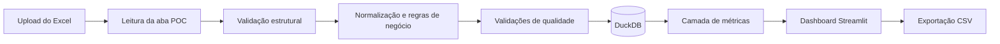

# SDD — Dashboard de consumo e estoque imobiliário

| Campo | Definição |
|---|---|
| Documento | Software Design Document |
| Versão | 1.0 |
| Estado | Pronto para implementação |
| Aplicação | Dashboard local em Python e Streamlit |
| Público principal | Gestão comercial |
| Fonte inicial | `Dados-Bloco.xlsx`, aba `POC` |

## 1. Resumo executivo

O dashboard deve permitir que a gestão comercial acompanhe o consumo observado, o estoque não vendido e a distribuição das vendas por empreendimento, bloco e andar. A aplicação usará uploads de snapshots da base para apresentar a situação atual e, quando houver ao menos dois snapshots, calcular a velocidade de vendas.

Neste documento, **demanda** significa demanda observada por meio de unidades marcadas como vendidas. A base não contém visitas, leads, propostas perdidas, intenção de compra ou procura reprimida. Portanto, a aplicação não deve apresentar consumo como uma medida completa da demanda de mercado.

### 1.1 Situação atual da base

| Indicador | Resultado |
|---|---:|
| Unidades únicas | 59.139 |
| Unidades vendidas | 49.040 |
| Estoque não vendido | 10.099 |
| Consumo geral | 82,9% |
| Empreendimentos | 178 |
| Combinações empreendimento–bloco | 1.818 |
| Cidades | 24 |
| IDs de unidade duplicados | 0 |

O cálculo usa `Status Unidade` normalizado, considerando vendida somente a unidade cujo status seja `VENDIDO`, sem diferenciar maiúsculas, minúsculas ou espaços nas extremidades.

### 1.2 Principais leituras comerciais

- O portfólio apresenta consumo geral elevado, mas o resultado agregado esconde empreendimentos com grande concentração de estoque.
- Os andares 2 a 5 apresentam consumo consolidado entre 85,7% e 86,8%. A partir do 7º andar, o consumo agregado tende a cair, chegando a 71,3% no 16º andar.
- Essa diferença não deve ser interpretada automaticamente como preferência causal por andares baixos. O conjunto de empreendimentos muda entre os andares e os andares mais altos possuem amostras menores.
- Os cinco maiores estoques estão em Parque Marista, Forte Alencar, Pontal de Maracaípe, Ilha de Safira e Residencial Vale do Amanhecer. Juntos, somam 2.097 unidades não vendidas, equivalentes a 20,8% do estoque não vendido da base.
- As 281 unidades sem andar informado estão vendidas. Elas devem permanecer nos totais gerais, mas não devem ser usadas para comparar o desempenho entre andares.

### 1.3 Consumo consolidado por andar

| Andar | Total | Vendidas | Não vendidas | Consumo |
|---:|---:|---:|---:|---:|
| 1 | 8.431 | 7.001 | 1.430 | 83,0% |
| 2 | 8.275 | 7.105 | 1.170 | 85,9% |
| 3 | 8.494 | 7.345 | 1.149 | 86,5% |
| 4 | 8.497 | 7.372 | 1.125 | 86,8% |
| 5 | 5.447 | 4.666 | 781 | 85,7% |
| 6 | 2.335 | 1.921 | 414 | 82,3% |
| 7 | 2.159 | 1.746 | 413 | 80,9% |
| 8 | 2.159 | 1.723 | 436 | 79,8% |
| 9 | 2.078 | 1.612 | 466 | 77,6% |
| 10 | 1.774 | 1.377 | 397 | 77,6% |
| 11 | 1.693 | 1.320 | 373 | 78,0% |
| 12 | 1.474 | 1.141 | 333 | 77,4% |
| 13 | 1.416 | 1.065 | 351 | 75,2% |
| 14 | 1.214 | 902 | 312 | 74,3% |
| 15 | 1.096 | 791 | 305 | 72,2% |
| 16 | 980 | 699 | 281 | 71,3% |
| 17 | 633 | 473 | 160 | 74,7% |
| 18 | 424 | 314 | 110 | 74,1% |
| 19 | 131 | 86 | 45 | 65,6% |
| 20 | 132 | 91 | 41 | 68,9% |
| 21 | 16 | 9 | 7 | 56,3% |
| Não informado | 281 | 281 | 0 | 100,0% |

Os resultados dos andares 19 a 21 devem exibir o tamanho da amostra ao lado do percentual. O grupo `Não informado` deve aparecer separado e nunca compor rankings de andar.

### 1.4 Empreendimentos com maior estoque não vendido

| Posição | Empreendimento | Total | Vendidas | Não vendidas | Consumo |
|---:|---|---:|---:|---:|---:|
| 1 | PARQUE MARISTA | 576 | 92 | 484 | 16,0% |
| 2 | FORTE ALENCAR | 492 | 63 | 429 | 12,8% |
| 3 | PONTAL DE MARACAÍPE | 600 | 174 | 426 | 29,0% |
| 4 | ILHA DE SAFIRA | 384 | 3 | 381 | 0,8% |
| 5 | RESIDENCIAL VALE DO AMANHECER | 480 | 103 | 377 | 21,5% |
| 6 | TERRAZZO PARNAÍBA | 416 | 42 | 374 | 10,1% |
| 7 | RESIDENCIAL FORTITUDINE | 384 | 17 | 367 | 4,4% |
| 8 | SOLAR DAS AMENDOEIRAS | 440 | 101 | 339 | 23,0% |
| 9 | TORRES DO PITIMBU | 328 | 4 | 324 | 1,2% |
| 10 | ALTIPLANO VILLAGE | 480 | 170 | 310 | 35,4% |

Esse ranking identifica concentração de estoque, não prioridade comercial automática. A decisão de atuação deve considerar lançamento, disponibilidade real, preço, tipologia, bloqueios e estratégia de cada empreendimento.

### 1.5 Composição do estoque não vendido

| Status normalizado | Unidades | Participação no estoque não vendido |
|---|---:|---:|
| EXCLUSIVO PLATAFORMA | 5.291 | 52,4% |
| NÃO LANÇADO | 2.437 | 24,1% |
| PRÉ VENDA | 982 | 9,7% |
| PERMUTADO | 448 | 4,4% |
| BLOQUEADO | 408 | 4,0% |
| RESERVADO COM CONTRATO PRE ATIVO | 286 | 2,8% |
| LANÇADO | 175 | 1,7% |
| RESERVA PARA PERMUTA | 38 | 0,4% |
| RESERVADO | 34 | 0,3% |
| **Total** | **10.099** | **100,0%** |

O dashboard deve usar o rótulo **estoque não vendido**. Ele não deve chamar automaticamente todas essas unidades de oferta ativa, pois a base inclui unidades não lançadas, bloqueadas, reservadas e permutadas.

## 2. Objetivos e limites

### 2.1 Objetivos do MVP

1. Importar e validar um snapshot em Excel.
2. Apresentar consumo e estoque no total e por cidade, empreendimento, bloco, andar e tipologia.
3. Identificar empreendimentos e andares com maior estoque remanescente.
4. Expor problemas de qualidade que afetem a interpretação.
5. Preservar snapshots para calcular velocidade de vendas em cargas futuras.
6. Exportar o recorte filtrado em CSV.

### 2.2 Fora do escopo

- Previsão estatística de vendas.
- Elasticidade de preço ou recomendação automática de preço.
- Medição de demanda não convertida.
- Alteração ou correção automática da planilha de origem.
- Autenticação, perfis de acesso ou operação multiusuário.
- Integração online com CRM, ERP ou data warehouse.

## 3. Regras de negócio

### 3.1 Classificação de venda

```text
status_normalizado = UPPER(TRIM(Status Unidade))
is_sold = status_normalizado == "VENDIDO"
```

`Status Unidade CRM` é um campo de reconciliação. Ele não altera `is_sold`.

### 3.2 Métricas principais

| Métrica | Regra |
|---|---|
| Total de unidades | Contagem distinta de `ID da Unidade` no recorte atual |
| Vendidas | Contagem distinta de unidades com `is_sold = true` |
| Estoque não vendido | `total_unidades - vendidas` |
| Consumo | `vendidas / total_unidades` |
| Participação do estoque | `estoque do grupo / estoque total do recorte` |

Se o denominador for zero, o resultado percentual deve ser exibido como `n.d.`, nunca como zero.

Todas as métricas devem ser recalculadas depois da aplicação dos filtros. Percentuais consolidados devem ser calculados a partir dos numeradores e denominadores filtrados, e não pela média simples dos percentuais dos grupos.

### 3.3 Dimensão de andar

- Usar `Posição Vertical` como andar.
- Converter valores inteiros válidos para número.
- Converter ausências para `Andar não informado`.
- Incluir o grupo sem andar nos KPIs gerais.
- Excluir o grupo sem andar de heatmaps, ordenações e comparações entre andares, salvo quando o usuário pedir sua exibição.
- Não corrigir automaticamente valores acima de `Pavimentos`; gerar alerta de qualidade.

### 3.4 Snapshots repetidos

- `snapshot_date` é informado pelo usuário durante a importação e não é inferido de `Data Base`.
- A combinação `snapshot_date + unit_id` deve ser única.
- Se a data já existir, a importação deve ser recusada por padrão.
- A substituição exige a opção explícita `Substituir snapshot existente`.
- A substituição somente ocorre após a nova carga passar por todas as validações e dentro de uma transação.
- O registro anterior em `import_runs` permanece com estado `REPLACED` para auditoria.

## 4. Contrato de entrada

### 4.1 Arquivo

- Formato: `.xlsx`.
- Aba obrigatória: `POC`.
- Linha de cabeçalho esperada: linha 2.
- Linhas seguintes: uma unidade por registro.
- Fórmulas das colunas auxiliares não são necessárias para o cálculo do consumo.

### 4.2 Colunas

| Coluna de origem | Obrigatória | Uso |
|---|:---:|---|
| ID Empreendimento | Sim | Identificador estável do empreendimento |
| ID Bloco | Sim | Identificador estável do bloco |
| ID da Unidade | Sim | Identificador único da unidade |
| Cidade | Sim | Filtro e agregação |
| Empreendimento | Sim | Filtro, agregação e rótulo |
| Bloco | Sim | Filtro, agregação e rótulo |
| Unidade | Sim | Rótulo operacional |
| Status Unidade | Sim | Fonte oficial de `is_sold` |
| Status Unidade CRM | Não | Reconciliação de status |
| Pavimentos | Sim, aceita vazio | Validação de coerência |
| Posição Vertical | Sim, aceita vazio | Dimensão de andar |
| Tipologia | Não | Filtro analítico |
| Subtipologia | Não | Filtro analítico |

### 4.3 Validações de importação

Erros bloqueantes:

- aba `POC` ausente;
- coluna obrigatória ausente;
- `ID da Unidade` vazio;
- `ID da Unidade` duplicado dentro do snapshot;
- data do snapshot inválida;
- snapshot já existente sem confirmação de substituição.

Alertas não bloqueantes:

- andar ausente;
- pavimentos ausentes;
- andar maior que pavimentos;
- status da unidade diferente do status do CRM;
- tipologia ou subtipologia ausentes;
- status ainda não reconhecido pelo catálogo atual.

## 5. Qualidade da carga inicial

| Verificação | Registros | Proporção | Tratamento |
|---|---:|---:|---|
| Andar não informado | 281 | 0,5% | Manter nos totais e separar nas análises de andar |
| Pavimentos não informado | 224 | 0,4% | Alertar; não impedir consumo |
| Andar superior aos pavimentos informados | 264 | 0,4% | Alertar; não corrigir automaticamente |
| Divergência entre status oficial e CRM | 237 | 0,4% | Usar `Status Unidade` e listar divergências |
| `Data Base` preenchida | 571 | 1,0% | Não usar para velocidade |
| `Data Base` vazia | 58.568 | 99,0% | Exigir data manual do snapshot |
| IDs de unidade duplicados | 0 | 0,0% | Cargas futuras com duplicidade serão bloqueadas |

Das 237 divergências de venda, 217 registros aparecem como vendidos somente no CRM e 20 somente no status oficial. O painel de qualidade deve permitir exportar esses registros para conciliação.

## 6. Arquitetura



### 6.1 Componentes

| Componente | Responsabilidade |
|---|---|
| Interface Streamlit | Upload, filtros, páginas, mensagens e exportações |
| Importador Excel | Ler a aba e mapear colunas da origem |
| Validador | Separar erros bloqueantes de alertas |
| Transformador | Normalizar textos, tipos, andar, status e indicadores |
| Repositório DuckDB | Persistir snapshots e auditoria das importações |
| Camada de métricas | Calcular KPIs, agregações e transições entre snapshots |
| Visualizações Plotly | Heatmap, barras, séries temporais e tooltips |

### 6.2 Organização recomendada

```text
app.py
src/
  importer.py
  validation.py
  transform.py
  storage.py
  metrics.py
  exports.py
  views/
    overview.py
    floors.py
    enterprise.py
    velocity.py
    quality.py
data/
  consumo.duckdb
tests/
```

As dependências principais são Streamlit, pandas, openpyxl, DuckDB, Plotly e pytest. O arquivo do banco e os uploads permanecem locais.

## 7. Modelo de dados

### 7.1 `import_runs`

| Campo | Tipo | Regra |
|---|---|---|
| run_id | UUID | Chave primária |
| snapshot_date | DATE | Data informada pelo usuário |
| file_name | VARCHAR | Nome original do arquivo |
| file_sha256 | VARCHAR | Rastreabilidade e detecção de repetição |
| imported_at | TIMESTAMP | Momento da carga |
| row_count | INTEGER | Quantidade importada |
| warning_count | INTEGER | Total de alertas |
| status | VARCHAR | `ACTIVE`, `FAILED` ou `REPLACED` |
| replaced_run_id | UUID, nulo | Execução substituída, quando aplicável |

### 7.2 `unit_snapshots`

| Campo | Tipo | Origem ou regra |
|---|---|---|
| run_id | UUID | Referência à importação |
| snapshot_date | DATE | Data do snapshot |
| enterprise_id | VARCHAR | `ID Empreendimento` |
| block_id | VARCHAR | `ID Bloco` |
| unit_id | VARCHAR | `ID da Unidade` |
| city | VARCHAR | `Cidade` |
| enterprise_name | VARCHAR | `Empreendimento` |
| block_name | VARCHAR | `Bloco` |
| unit_name | VARCHAR | `Unidade` |
| typology | VARCHAR, nulo | `Tipologia` |
| subtypology | VARCHAR, nulo | `Subtipologia` |
| status_unit_raw | VARCHAR | Valor original de `Status Unidade` |
| status_unit_normalized | VARCHAR | Texto sem espaços e em maiúsculas |
| status_crm_raw | VARCHAR, nulo | Valor original do CRM |
| reported_floors | INTEGER, nulo | `Pavimentos` |
| floor | INTEGER, nulo | `Posição Vertical` |
| is_sold | BOOLEAN | Regra oficial de venda |
| floor_missing | BOOLEAN | Andar não informado |
| floor_above_reported | BOOLEAN | Andar maior que pavimentos |
| status_conflict | BOOLEAN | Venda divergente entre os dois status |

Chave única: `(snapshot_date, unit_id)`.

## 8. Experiência do usuário

### 8.1 Navegação e filtros

A barra lateral deve conter:

- data do snapshot;
- cidade;
- empreendimento;
- bloco;
- tipologia;
- status oficial;
- opção `Incluir andar não informado` nas tabelas detalhadas.

Os filtros devem ser encadeados. Por exemplo, a seleção de uma cidade limita a lista de empreendimentos e blocos disponíveis. Um botão `Limpar filtros` restaura o snapshot inteiro.

### 8.2 Página Visão geral

Componentes, na ordem:

1. KPIs de total, vendidas, estoque não vendido e consumo.
2. Barra horizontal com os dez maiores estoques por empreendimento.
3. Barras de estoque por status oficial.
4. Consumo e quantidade de unidades por andar em painéis alinhados.
5. Tabela resumida por empreendimento, ordenável e exportável.

### 8.3 Página Consumo por andar

- Heatmap com empreendimento nas linhas e andar nas colunas.
- Cor representa consumo; células sem unidades ficam neutras e vazias.
- Texto da célula pode mostrar o consumo quando houver espaço.
- Tooltip mostra empreendimento, andar, total, vendidas, estoque e consumo.
- O tamanho da amostra deve permanecer visível no tooltip.
- A tabela abaixo do heatmap deve permitir ordenar por estoque ou consumo.

### 8.4 Página Detalhe do empreendimento

- Exigir a seleção de um empreendimento.
- Mostrar KPIs do empreendimento.
- Permitir filtro opcional de bloco.
- Exibir barras empilhadas de vendidas e não vendidas por andar.
- Exibir consumo percentual por andar em gráfico separado, evitando eixo duplo.
- Mostrar composição do estoque por status e tabela de unidades filtradas.

### 8.5 Página Velocidade

Sem um segundo snapshot, apresentar:

> Velocidade indisponível. Importe um segundo snapshot com data posterior para calcular transições de venda.

Com dois ou mais snapshots:

- série temporal de consumo;
- novas vendas, reversões e vendas líquidas por intervalo;
- velocidade mensal normalizada;
- variação do consumo em pontos percentuais;
- comparação por empreendimento, bloco e andar.

### 8.6 Página Qualidade dos dados

- KPIs de erros e alertas.
- Tabela por tipo de problema.
- Detalhe das linhas afetadas.
- Comparação entre status oficial e CRM.
- Exportação CSV dos registros com problema.
- Histórico de importações e substituições.

### 8.7 Padrão visual

| Uso | Cor |
|---|---|
| Vendido | Verde `#137A4A` |
| Estoque não vendido | Cinza `#6B7280` |
| Alerta | Âmbar `#B7791F` |
| Erro bloqueante | Vermelho `#B42318` |
| Ausência de dado | Cinza-claro `#E5E7EB` |

- Idioma: português brasileiro.
- Contagens: número inteiro com separador de milhar.
- Percentuais: uma casa decimal na interface; duas casas apenas em validações.
- Nenhum gráfico deve depender somente de cor; tooltips e rótulos devem carregar os valores.
- Evitar gráficos de pizza e médias simples de percentuais.

## 9. Velocidade de vendas

Para dois snapshots consecutivos `t-1` e `t`, comparar somente unidades presentes nos dois snapshots para as transições de status.

| Métrica | Definição |
|---|---|
| Novas vendas | Unidade não vendida em `t-1` e vendida em `t` |
| Reversões | Unidade vendida em `t-1` e não vendida em `t` |
| Vendas líquidas | `novas_vendas - reversões` |
| Velocidade mensal | `novas_vendas / dias_entre_snapshots × 30` |
| Variação de consumo | `consumo_t - consumo_t-1`, em pontos percentuais |
| Unidades adicionadas | Ausentes em `t-1` e presentes em `t` |
| Unidades removidas | Presentes em `t-1` e ausentes em `t` |

Unidades adicionadas e removidas alteram o denominador, mas não devem ser classificadas automaticamente como venda ou reversão. Intervalos com zero ou número negativo de dias são inválidos. O primeiro snapshot deve mostrar métricas de velocidade como `n.d.`.

## 10. Exportações

O botão de exportação deve respeitar todos os filtros visíveis e gerar CSV em UTF-8 com BOM para compatibilidade com Excel.

Exportações previstas:

1. Resumo por empreendimento e andar.
2. Unidades do recorte atual.
3. Problemas de qualidade.
4. Transições entre snapshots, quando disponíveis.

Cada arquivo deve incluir `snapshot_date` e um cabeçalho com nomes estáveis em `snake_case`.

## 11. Estados de erro

| Situação | Comportamento esperado |
|---|---|
| Arquivo inválido | Não persistir dados e informar o motivo |
| Aba ausente | Informar que a aba `POC` é obrigatória |
| Colunas ausentes | Listar exatamente as colunas faltantes |
| IDs vazios ou duplicados | Bloquear a carga e oferecer CSV dos registros |
| Snapshot repetido | Solicitar substituição explícita |
| Filtro sem registros | Exibir estado vazio, não KPIs iguais a zero |
| Denominador zero | Mostrar `n.d.` |
| Apenas um snapshot | Mostrar velocidade indisponível |
| Banco indisponível | Não aceitar nova carga e preservar o arquivo original |

## 12. Requisitos não funcionais

- Operação local e sem envio de dados para serviços externos.
- Importação transacional: uma falha não deixa snapshot parcial.
- Resultados determinísticos para o mesmo arquivo, data e regra de negócio.
- Registro do hash do arquivo e do momento da carga.
- Processamento da carga inicial de 59.139 linhas em até 30 segundos em um computador corporativo comum.
- Atualização dos filtros e visuais em até 2 segundos após a leitura do snapshot.
- Suporte inicial a pelo menos 1 milhão de linhas históricas no DuckDB.
- Testes automatizados independentes da interface.

## 13. Testes

### 13.1 Transformação e métricas

- Normalizar `VENDIDO`, `Vendido` e valores com espaços como vendidos.
- Manter todos os demais status como não vendidos.
- Reconciliar 59.139 unidades, 49.040 vendidas, 10.099 não vendidas e 82,92% de consumo.
- Confirmar que o total por status não vendido soma 10.099.
- Confirmar ausência de IDs duplicados na carga inicial.
- Validar denominador zero como `n.d.`.
- Validar que percentuais agregados usam soma dos componentes.

### 13.2 Andares e filtros

- Reconciliar os primeiros, intermediários e últimos andares contra a planilha.
- Confirmar, por exemplo, o 1º andar com 8.431 unidades e 83,04% de consumo.
- Manter as 281 unidades sem andar nos KPIs gerais.
- Remover essas unidades apenas das comparações entre andares.
- Recalcular KPIs ao combinar cidade, empreendimento, bloco, tipologia e status.
- Confirmar que o CSV exportado contém exatamente o recorte visível.

### 13.3 Qualidade

- Reproduzir 224 registros sem pavimentos.
- Reproduzir 264 registros com andar superior aos pavimentos.
- Reproduzir 237 conflitos entre os campos de status.
- Bloquear arquivo com ID vazio ou duplicado.
- Não alterar nem excluir registros apenas por gerarem alerta.

### 13.4 Snapshots e velocidade

- Mostrar `n.d.` para velocidade no primeiro snapshot.
- Detectar transição de não vendido para vendido como nova venda.
- Detectar transição inversa como reversão.
- Não contar unidade nova como venda.
- Não contar unidade removida como reversão.
- Normalizar corretamente intervalos diferentes de 30 dias.
- Bloquear intervalos de zero dia ou datas invertidas.
- Rejeitar snapshot repetido e testar a substituição transacional.

### 13.5 Interface

- Verificar filtros encadeados e restauração pelo botão `Limpar filtros`.
- Verificar tooltips do heatmap com total, vendidas, estoque e consumo.
- Verificar estados vazios sem números enganosos.
- Verificar legibilidade dos gráficos e contraste das cores.

## 14. Critérios de aceite

O MVP estará aceito quando:

1. importar a base inicial sem alterar o arquivo de origem;
2. bloquear erros estruturais e registrar alertas de qualidade;
3. reproduzir todos os totais de referência deste documento;
4. recalcular KPIs e visualizações com qualquer combinação válida de filtros;
5. apresentar os cinco módulos definidos;
6. exportar CSVs equivalentes ao recorte filtrado;
7. armazenar snapshots sem duplicar unidade e data;
8. calcular velocidade somente quando houver snapshots válidos suficientes;
9. manter rastreabilidade por data, arquivo, hash e execução de importação;
10. passar pelos testes automatizados de métricas, qualidade e transições.

## 15. Sequência de implementação

1. Implementar contrato de entrada, validações e normalização.
2. Criar esquema DuckDB e importação transacional.
3. Implementar a camada única de métricas e testes de reconciliação.
4. Construir Visão geral, Consumo por andar e Detalhe do empreendimento.
5. Construir Qualidade dos dados e exportações.
6. Implementar persistência de múltiplos snapshots e Velocidade.
7. Executar testes de aceitação e validação visual com a base inicial.

## 16. Premissas finais

- `Status Unidade` é a única fonte oficial para classificar venda.
- `PERMUTADO` e todos os demais status diferentes de `VENDIDO` permanecem no estoque não vendido para esta métrica.
- `Status Unidade CRM` serve somente para reconciliação.
- `Posição Vertical` representa o andar para fins analíticos.
- A aplicação não corrige automaticamente dados inconsistentes.
- `Data Base` não será usada para velocidade devido à cobertura de apenas 571 registros.
- A data do snapshot é obrigatória e fornecida no momento do upload.
- O MVP é local, sem autenticação e sem integração externa.

